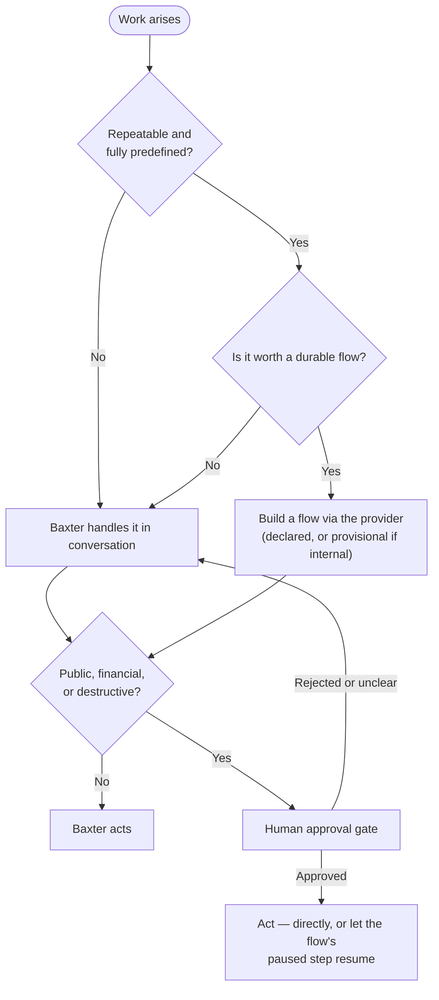
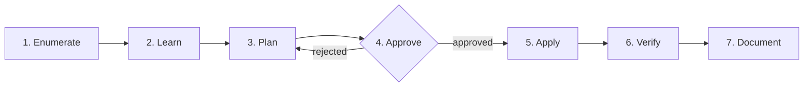
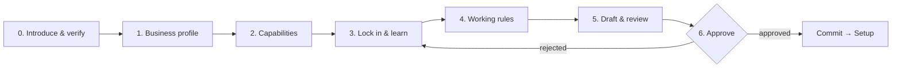

# Business AI Assistant — Architecture Framework

*System: Baxter | Blueprint v0.2.2 | Status: foundational architecture*

**Objective.** A repeatable business system assembled from a **fixed, portable blueprint** plus **swappable services and hosts**. The blueprint is identical in every deployment; the agent platform, the services, and the automation provider are chosen per deployment.

> **Scope.** Generic architecture only. Vendor selection, hosting, pricing, and business-specific configuration are handled separately.

---

## 1. The Core Concept

- The **blueprint** provides what is the same in every business: the behaviour (Baxter), the protocols, the config schema, the invariants, and the contract every service must satisfy.
- The **host** provides the runtime: an agent, a channel, a tool plane, memory, files and possibly a scheduler. Hosts differ; the deployment declares which ports each one supplies (§9).
- **Services** supply business capability (Website, CRM, Email Marketing, Social, Accounting, …). They are optional, interchangeable, and are reached two ways: by Baxter in conversation, and by flows that call them directly.
- **Automation providers** (n8n, Zapier, Make, host-native routines) are optional services that build and run flows. They are not part of the core and may be added at any time.
- The **assistant's name and persona** are deployment settings chosen by the owner at first contact; **Baxter** is the blueprint's codename and the Coordinator role in documentation.
- Rule of thumb: **the blueprint never changes per business — services, providers, hosts and identity do.**

---

## 2. Parts of the System

| Part | Role | Notes |
|---|---|---|
| **Baxter — Coordinator** | Judgment, conversation, routing, approval gates, memory governance, configuration | The only source of judgment in the system |
| **Host runtime** | Agent loop, channel, tool plane, memory, files, possibly a scheduler | Supplied by the platform; mapped by a requirements document (§9) |
| **Business services** | CRM, accounting, email, social, website | Two surfaces each: agent and flow (§5) |
| **Automation provider** *(optional)* | Builds and runs deterministic flows between services | A connector with a meta-capability; may be absent |
| **Run ledger** | Records every flow, run and result | The truth of what automation exists and what it did |
| **Secrets source** | External vault, host-native store, or hybrid | Declared per deployment (§7.4) |
| **Memory** | Long-term knowledge | Core service or host-native port (§7.5) |
| **Data storage** | Files and artifacts | Core-owned or host-owned |
| **Backup / recovery** | Off-host, versioned copies of what the core owns | Provider workflows are recompiled from specs (§7.1) |
| **Messaging Channel** | Human gateway: conversation, alerts, approval gates | e.g. Telegram, Slack, the host UI |
| **API / Event gateway** | Machine path into services | MCP first, documented REST otherwise |

**Two modes, not two layers:** conversation is Baxter acting on a service; a flow is services acting on each other. Determinism belongs to flows, judgment to Baxter, approval to a human — but neither mode owns the other.

---

## 3. Architecture Diagram

```text
Business owner ──┐
Employees ───────┴──────────►  [ Messaging Channel ]
                                      │ conversation · requests · approvals
                                      ▼
                        ┌─────────────────────────────┐
                        │  CORE (identical everywhere) │
                        │                              │
                        │  Baxter — judgment · gates   │
                        │  Config workspace (git)      │
                        │  Run ledger                  │
                        │  Secrets broker / adapter    │
                        │  Memory + storage            │
                        └─────────────────────────────┘
                                      │
              conversation (tools)    │    author / inspect / results
                 ┌────────────────────┴───────────────────┐
                 ▼                                        ▼
      ┌─────────────────────┐                 ┌──────────────────────┐
      │  Connected services │◄─── flows ─────►│  Automation provider │
      │  CRM · Email · …    │   (direct)      │  n8n · Zapier · …    │
      └─────────────────────┘                 └──────────────────────┘
```

**How to read it:**

- Baxter holds a tool connection to every enrolled service; that is the conversation path.
- The automation provider is a service like any other. Baxter instructs it to build a flow; after that the services exchange data directly and Baxter is out of the path.
- Results come back through the run ledger: flow → run → output. Baxter checks the provider, then the service, only when it needs the outcome.
- Connectors never talk to each other outside a declared flow or a recorded provisional flow.
- Per-business configuration lives in the git workspace. The host's own settings are an implementation detail and never the source of truth.

---

## 4. Division of Labour

| Work type | Owner | Examples |
|---|---|---|
| One-off ask, lookup, interpretation, drafting | **Baxter (conversation)** | "What did we invoice Acme?", "Draft a reply", "Which job is late?" |
| Repeatable, predefined, no interpretation | **Flow** | New contact → email list; invoice status → job; website lead → CRM |
| Public, customer-visible, financial, destructive | **Human approval gate** | Publish a post, send a campaign, issue a refund, bulk delete |



**Escalation chain:** flow → Baxter → human.

### 4.1 Baxter — Internal Roles

The default is **one agent with scoped tools, not many**. Specialist agents exist only where a single shared context becomes unsafe — three drivers justify a split:

1. **Credential / trust scope** — an agent that can publish or touch money must not hold routine credentials.
2. **Context isolation** — creative and operational work pollute each other's memory.
3. **Concurrency** — a long creative job must not block an urgent operational request.

| Role | Scope (tools / memory / credentials) | Activated when | Never does |
|---|---|---|---|
| **Baxter — Coordinator** | Routing, approval gates, memory governance, setup | Always | — |
| **Content Specialist** | Drafting and brand voice; content / social tools; creative memory | Deployment includes content or social services | Publishes without the Coordinator's gate |
| **Operations Specialist** | Customer, job, finance tasks; CRM / accounting tools | Deployment includes CRM or accounting | Touches publishing tools or acts publicly |
| **Customer Engagement Specialist** | Customer chat; lookup tools; create CRM contacts | Deployment includes a customer chat channel | Commits the business — no promises, quotes, cancellations or refunds |

**Rules:**

1. **Business people talk only to the Coordinator.** Customers are the exception: they reach only the Customer Engagement Specialist.
2. **Roster fixed by the blueprint, activation per deployment.** Roles exist in the blueprint; a deployment activates only what its services need.
3. **Scopes are locked.** Each specialist holds only its own tools, memory and credentials.
4. **No specialist publishes, spends or destroys.** Every such action passes a human gate — including when it runs inside a flow.
5. **Memory stays separate.** Each role keeps its own memory scope; the Coordinator persists summaries.
6. **Design the seams now, activate later.** Default deployments run Baxter alone.
7. **Roles, not profiles.** Profiles, bots and subagents are implementation details. A host's task-bot feature never creates an unauthorised role.

---

## 5. Connectors and Providers

A **connector** is any enrolled service. Three kinds:

| Kind | What it is | Examples |
|---|---|---|
| `business` | A service that holds or moves business data | CRM, accounting, email marketing, social, website |
| `automation` | A service that builds and runs flows between other connectors | n8n, Zapier, Make, host routines |
| `broker` | A service that fronts many apps and holds their grants | Composio, Pipedream |

Every connector declares **two surfaces**:

- **Agent surface** — how Baxter may converse with it (`mcp`, `openapi`, `rest`, or `none`). Some services are read-only or not safe to expose to the agent at all.
- **Flow surface** — how a flow may call it (`rest`, `webhook`, `native`, or `none`).

A surface may be absent. A connector that exposes neither is not enrollable.

**Connector rules:**

1. Optional and swappable — added only when a deployment needs them, replaceable without touching the blueprint.
2. Enrolled only through onboarding and setup. Never added, removed or re-scoped in conversation.
3. Provisioned by the core; after provisioning, direct traffic is allowed **only** inside a declared flow or a recorded provisional flow.
4. Exactly one business connector per deployment is the system of record for customer data. Other connectors may hold bounded replicas with a declared direction.
5. Public, financial or destructive actions pass a human gate, wherever they execute.
6. **MCP first** wherever the vendor provides it; documented REST otherwise. The standard is chosen once per connector.
7. **Native integration precedence.** If two vendors already integrate, the native path wins over building a flow. The flow exists only where no native path is adequate.
8. A deployment may legally have **zero** automation providers and **zero** flows.

### 5.1 Automation providers

An automation provider is a connector whose special capability is to wire other connectors together. The provider contract (`connectors/automation.md`) requires it to declare:

- **authoring** — `programmatic` (Baxter can create and edit flows via an API/MCP) or `manual` (the owner builds in the vendor UI; Baxter records and verifies);
- **pause** — whether a flow can stop and wait for a human approval;
- **runs** — whether Baxter can read run history and status;
- **triggers/actions** — schedule, webhook, event, and the action classes it can perform;
- **idempotency** — whether a retried step can be made safe.

A provider without `pause` may never hold credentials for a gated action. A provider without `runs` cannot be the default source of results.

### 5.2 Flows

A flow is a durable route between two connectors:

```text
trigger → steps → (approval pause?) → final action → outcome
```

- **Declared flows** are agreed during onboarding and recorded in `deployment.yaml` with a portable spec in `flows/<id>.md`.
- **Provisional flows** are built in conversation for internal, reversible work. They are recorded in the run ledger with `origin: conversational`, scoped credentials, and an expiry. They are promoted to declared, or they expire and are revoked (§7.7).
- **Gated flows** publish, send, spend or destroy. They must pause for the owner; if the provider cannot pause, Baxter performs that action itself after approval.
- Flows never generate content and never make judgment calls. A step that needs either calls back to Baxter.

---

## 6. Deployment Model

A new business deployment is assembly, not engineering:

1. **Choose the host** and read its requirements document (`docs/<harness>-requirements.md`). Record its ports and degraded capabilities.
2. **Install** the blueprint — as a skill where the host supports it, as an instruction brief or an operator runbook where it does not (§8.1).
3. **Onboard** — run the questionnaire, produce the Deployment Config, commit it.
4. **Enrol services** — connect the chosen connectors with their declared surfaces and secret references.
5. **Add automation, if needed** — zero or more providers, chosen then or later.
6. **Build flows** — declared flows get specs and are compiled; provisional flows stay in the ledger.
7. **Run setup** — plan, approve, apply, verify, document.

> **Operational defaults:** per-business configuration is code in a git workspace, backed up per the owner's choice; the secret source is declared, not assumed; setup is agent-driven with the owner at the gates.

---

## 7. Core Operations

All four capabilities — backup, configuration, memory, secrets — are blueprint-owned in structure and deployment-decided in mechanism.

### 7.1 Backup and Restoration

**Principle: each party backs up what it owns.**

| Item | Owner | Restores |
|---|---|---|
| Config workspace, flow specs, learned profiles | Core | Every per-business setting and route definition |
| Memory, files, artifacts | Core or host, as declared | Agent knowledge and working files |
| Flow definitions *inside the provider* | Provider | Its own runtime state — or recompiled from the spec |
| Service data (CRM, accounting, …) | Vendor | Their own durability |

**Rules:**

1. **Off-host and nightly** for everything the core owns.
2. **Versioned retention** — restore any point in time.
3. **Specs make flows portable.** A lost provider is rebuilt by recompiling the flow specs, not by hoping the vendor exported them.
4. **Restore drills are mandatory.** Wipe, re-apply config, restore data, verify flows.

### 7.2 Configuration as Code

Every per-business difference lives in a **git workspace** and is *applied*, never typed into the running system.

**Rules:**

1. The workspace is the source of truth. The host's native settings are an implementation detail.
2. Every change is versioned and reversible.
3. Deployments are reproducible: install → workspace → onboard → apply.
4. Backup: private remote if the owner provides one; otherwise local-only with an explicit warning. Business configuration is never pushed to a public repository.
5. **Versioned and pinned.** The blueprint (`VERSION`), the schema (`schema_version`), each Connector Pack and the host adapter are pinned in the config. Updates are explicit, never silent.

### 7.3 Memory Management

Three tiers, all core-owned or host-declared:

| Tier | Holds | Lifecycle |
|---|---|---|
| Working | Active conversation and task context | Volatile |
| Long-term | Persistent facts and preferences | Store declared per deployment; summarised and pruned; backed up |
| Artifacts | Files and media | File store; referenced, never duplicated |

**Rules:** memory is core-owned; no parallel copies of connector data; retrieve, don't stuff; keep it lean; raw chat and email are not retained.

### 7.4 Secrets Management

Secrets are a **declared source**, chosen per deployment:

| Source | What it means | Trade-off |
|---|---|---|
| `vault` | External password manager (Bitwarden, 1Password, Infisical) reached through a Secrets Service | Strongest central scoping and audit; needs a vault and a root secret |
| `native` | The host's own encrypted store (profile env, connector credentials, Vault) | Zero extra infrastructure; scoping is limited to what the host enforces |
| `hybrid` | Vault for core-owned secrets; native for connector grants the host brokers | Practical default for platforms with their own connector OAuth (Rakazo, Grok Bot, Nod) |

**Rules:**

1. **References, never values.** The config holds source + reference + scope + rotation; the store holds the value.
2. **One path to values.** Either the Secrets Service or the host adapter; never both for the same secret.
3. **Least privilege where the source allows it.** If the native store cannot enforce per-role scopes, the deployment declares the limitation and compensates with provider-side scopes, short-lived grants, and rotation.
4. **Secrets never enter the repository, flow definitions or chat.** A value pasted into chat is compromised; instruct rotation.
5. **Backup follows the source.** Vault joins the encrypted backup; native stores join only if the platform exports them, otherwise the build is documented in the runbook.
6. One root secret, well guarded, with an offline copy.

### 7.5 The Memory Service — Store and Mechanism

The deployment chooses the mechanism; the requirement is constant.

| Decision | Options | Guidance |
|---|---|---|
| Provider | `core-service` · `host-native` | `core-service` is portable; `host-native` is opt-in and lossy |
| Store | sqlite · postgres-pgvector · host store | Match the host; keep it inside the backup scope |
| Namespaces | per role on/off | All activated roles enabled |
| Retention | summarise / prune schedule | e.g. 14 / 90 days |
| Embeddings | off · local · api | Off by default; a later upgrade behind the same recall API |

Host-native memory must be declared as degraded for portability. Role scoping is enforced by the service where one exists; otherwise the host's isolation model applies and is recorded.

### 7.6 Automation — the Optional Add-on

The automation provider is **not** a core component. It is an enrolled connector that can build flows between services. Consequences:

1. **Zero is valid.** A deployment can run conversation-only, or with native vendor syncs and no provider.
2. **Added later.** Adding n8n, Zapier or Make is a setup operation with its own plan and approval, not a rebuild.
3. **Baxter authors where it can.** With `authoring: programmatic`, Baxter creates and tests flows through the provider's MCP/API. With `manual`, the owner builds and Baxter records and verifies.
4. **Flows run without the agent.** Once built, services call each other directly.
5. **Results are polled or pushed through the ledger.** Baxter checks the provider for run status by default; checks a service only when the flow is native or the provider cannot report.
6. **No duplicate scheduling.** One scheduler of record per flow — the provider *or* the host's routines, never both.
7. **Portable specs.** Every flow has a provider-neutral spec in `flows/`. Swapping providers recompiles the spec; it does not re-interview the owner.

### 7.7 The Run Ledger

The ledger is the truth of automation in a deployment:

```text
flow id → provider → run id → status → output resource → approved by → expires
```

- Created at flow creation, updated on every run.
- Provisional flows carry `origin: conversational`, an expiry, and the scopes they hold.
- A flow with no run record after setup is an open item, not a working flow.
- The ledger is the source for the owner review: promote, keep, or revoke.

---

## 8. Setup and Self-Configuration

### 8.1 The Instruction Set — Content and Carrier

The **content** is fixed: the constitution, the protocols, the schema, the packs. The **carrier** depends on the host:

| Delivery mode | Host requirement | What is delivered |
|---|---|---|
| `skill` | Loads skills/plugins and files | `SKILL.md` + `references/` read on demand |
| `brief` | System prompt / persona / custom instructions | `references/brief.md` pasted in, workspace path supplied |
| `operator` | Only per-agent prompts and an admin UI | The requirements document is the runbook; an operator or setup agent creates bots, pastes the brief, connects tools |

**Minimum host floor:** an instruction channel, a tool plane (MCP or API), and a durable workspace. A host without all three cannot be a Baxter host; it can only be a service Baxter calls.

**No forks.** The brief is canonical and version-stamped; platform documents embed it, never rewrite it.

### 8.2 The Deployment Config — Shape and Schema

```text
baxter-workspace/deployments/<business>/
├── deployment.yaml
├── business-context.md
├── connector-proficiency/<connector>.md
├── flows/<id>.md
└── onboarding-draft.md      # during onboarding only
```

```yaml
schema_version: 2
deployment:
  name: harbour-electrical
  assistant:
    name: Nora                  # owner-chosen at Stage 0 — the runtime identity
    slug: nora
  core_version: 0.2.2
  business_context: business-context.md

harness:
  platform: rakazo                 # hermes | rakazo | grokbot | nod | openmausbot | generic
  delivery: brief                  # skill | brief | operator
  adapter_version: 1.0.0
  ports: { channel: native, runtime: native, instructions: partial,
           roles: partial, tools: native, memory: partial,
           scheduling: native, approvals: native, files: native,
           secrets: native, audit: partial }
  degraded: [memory, roles]

secrets:
  source: hybrid                   # vault | native | hybrid
  vault_path: vault/
  native_store: rakazo-connectors

memory:
  provider: host-native
  store: rakazo-postgres
  location: host
  namespaces: { coordinator: enabled, content: enabled, operations: enabled }
  retention: { summarise_after_days: 14, prune_after_days: 90 }
  embeddings: off

connectors:
  - name: crm
    kind: business
    system_of_record: true
    surfaces: { agent: mcp, flow: rest }
    connector_pack: connectors/crm.md
    pack_version: 1.1.0
    secrets: { source: native, ref: rakazo/connectors/crm,
               scope: [contacts.read, jobs.write] }
  - name: n8n
    kind: automation
    provider: n8n
    surfaces: { agent: mcp, flow: internal }
    connector_pack: connectors/n8n.md
    pack_version: 1.1.0
    capabilities: { authoring: programmatic, pause: true, runs: true }
    secrets: { source: vault, ref: vault/connectors/n8n }
  - name: email-marketing
    kind: business
    surfaces: { agent: mcp, flow: rest }
    connector_pack: connectors/email-marketing.md
    pack_version: 1.1.0
    secrets: { source: native, ref: rakazo/connectors/email }

roles:
  coordinator: { active: true }
  content: { active: true, scopes: [email-marketing] }
  operations: { active: true, scopes: [crm] }
  customer_engagement: { active: false }

channels:
  messaging: telegram/baxter-example
  approvers: { owner: t.me/owner-handle, staff: [] }
  customer_chat: []

flows:
  - id: new_contact_to_list
    from: crm
    to: email-marketing
    what: contact_synced
    spec: flows/new-contact-to-list.md
    provider: n8n
    approval: none
  - id: campaign_sent
    from: crm
    to: email-marketing
    what: campaign_sent
    spec: flows/campaign-sent.md
    provider: n8n
    approval: owner

approval_gates:
  default: owner

backup:
  mode: private-remote
  remote: git@example.com:business/baxter-config.git
```

**Identity.** `deployment.assistant` holds the owner-chosen name and slug; every runtime surface uses it. Baxter is only the codename.

**Schema.** `references/deployment.schema.json` (`schema_version: 2`) enforces structure and the semantic rules S1–S19. A config that fails either halts setup.

### 8.3 How Baxter Learns the Connectors

1. **Connector Packs** — capabilities, both surfaces, onboarding questions, checklist.
2. **Live self-description** — enumerate the MCP server or API at setup.
3. **The provider's capability matrix** — authoring, pause, runs, triggers.
4. **Documentation** — vendor docs referenced from the pack.

### 8.4 The Setup Protocol

Mandated by the Constitution:



1. **Enumerate** — read the config: host, secret source, connectors, providers, flows.
2. **Learn** — load packs; enumerate each connector's agent and flow surfaces; learn the provider's capabilities and the host's ports.
3. **Plan** — per-connector setup, flow specs, provider install, memory namespaces, channel enrollment, degraded ports.
4. **Approve** — the owner reviews the plan.
5. **Apply** — connect, install the provider if any, author or record flows, verify credentials exist.
6. **Verify** — smoke-test each surface; run each flow and check the end-to-end effect and the ledger.
7. **Document** — write the state back: config, flow ids, run ids, proficiency notes, degraded ports.

### 8.5 Guardrails

1. The protocol is mandatory: plan → approve → verify.
2. Configuration is code: every action lands in the repository.
3. Credentials stay with the declared source; references only.
4. Flows are declared or provisional; no undeclared automation.
5. A deployment is re-runnable: apply from the repository, verify.
6. The kill switch is real, and it reaches flows.

### 8.6 The Onboarding Protocol

Onboarding answers *what the business needs*; setup performs *how it is configured*.



**Sources of questions:** the core questionnaire, the Connector Packs' onboarding questions, and the schema as the destination map. Never improvised.

**Rules:** declaration not discovery; plain language; secrets out of the conversation; resumable; self-validated before the gate; full disclosure at the gate; lock in then learn.

---

## 9. Harness Adapters and Conformance

A harness is the agent platform a deployment runs on. The blueprint uses eleven **ports**; each harness supplies some natively, some partially, some not at all. Its requirements document (`docs/<harness>-requirements.md`) records the mapping.

| Port | What it must provide |
|---|---|
| Channel | A message surface for the owner and staff |
| Runtime | An agent loop that can follow the brief and call tools |
| Instructions | A way to load the skill, brief, or operator runbook |
| Roles | Isolation between coordinator and specialists, or a declared substitute |
| Tools | MCP client, REST/OpenAPI actions, or both |
| Memory | Long-term store or a declared host-native substitute |
| Scheduling | Flow triggers or routines, if flows are used |
| Approvals | A way to pause and ask the owner |
| Files | A workspace or document store |
| Secrets | Vault, native store, or hybrid |
| Audit | Run and action records, where available |

**Conformance levels:** `native` (the port works as the blueprint expects), `partial` (a documented workaround exists), `degraded` (the blueprint's guarantee cannot be met; the gap is declared in `deployment.yaml` and the safe fallback is named).

**Assessment loop:** probe the host → grade each port → choose delivery mode → write the requirements doc → run the conformance test (empty workspace, "become Baxter": it must create the workspace, start Stage 0, ask rather than invent, refuse a pasted credential) → record the result.

**Self-configuration is proposable, never self-certified.** When the host lets Baxter create bots or profiles, the creation plan is shown and approved like any other setup step.

---

## 10. Out of Scope

Vendor and product selection, hosting, pricing, and business-specific flow definitions. Connector and provider data durability belongs to the vendor.

**Recognised, deferred:** observability and audit beyond the ledger; chat-log retention; staging deployments; approval timeouts; work prioritisation.
